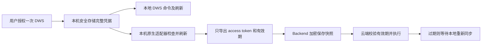

# 钉钉插件认证方案：一次授权、本地刷新、云端快照

状态：插件 0.3.4 已实现并完成本地合成回归及五平台预编译；未发布，真实 WeWork 0.5.4 端到端验收待完成。
基线：Wegent `wework-v0.5.4`，提交 `273372aa125bcc274bf4208a37c1ff71ee14b3f3`；钉钉插件 0.3.3；companion 使用 DWS v1.0.58。

## 已确定的产品行为

用户只授权一次 DWS。本地保留完整凭据及刷新权，云端只获得短期 access token 快照。云端凭据过期后停止执行，等本地刷新、重新同步后恢复；不要求云端自行刷新，也不要求本地关机后云端长期运行。

这替代此前的双授权提案，不引入第二次钉钉授权。

- 本地正常调用不依赖 WeWork Backend 或认证 Broker；仍需能访问钉钉服务。
- 同步失败不能删除、迁移、覆盖本地凭据，也不能让本地登录失败。
- 本地 refresh token 仍有效时自动续期，不要求再次扫码；确实过期或被撤销时才重新授权。
- 云端“等待同步”和“本地未登录”是不同状态，不能统一显示为登录失效。

## 数据流



本地是唯一刷新所有者。云端不会获得 refresh token、persistent_code、client_secret 或其他可延长授权的字段。没有 detach，不产生新的独占交接记录。

## 0.5.4 已核实的可复用能力

| 能力 | 固定 tag 的实现 |
| --- | --- |
| 短期凭据载体 | schema 和 SDK 支持 `credentialType: bearer`，要求非空 `token` |
| 非独占登记 | 省略 `exportMode` 时 migration 调用 enroll，不调用 detach |
| 自动同步 | 本地 automation 调用 `plugin.auth.automatic`，Backend 扫描具有 accountAuth 的已安装连接 |
| 更新快照 | PluginAuthSourceSync 对导出内容做 HMAC 观察，变化时更新连接 |
| 云端授权与执行 | 复用已有设备授权、加密存储、Broker 和私有原生 adapter 通道 |
| 周期 | Broker 通常每 15 秒协调一次；同一插件/连接完成一次导出后有约 60 秒冷却，还受批次与网络影响，不保证 15 秒内同步 |

以上针对源码基线。部署端 Backend、执行器、包版本及自动同步开关仍须实际验证。

## 连接声明与本地登录隔离

内部区分本地授权连接和云端快照连接，用户只进行一次本地授权。

| 内部连接 | 声明与用途 |
| --- | --- |
| dingtalk-local | localAuth、on_install，不声明 accountAuth；本地登录、health、退出不调用托管生命周期 |
| dingtalk-access | accountAuth、bearer、optional；没有第二个 localAuth 登录流程 |

快照连接的声明示意：

```json
{
  "slug": "dingtalk-access",
  "authPolicy": "optional",
  "accountAuth": {
    "protocolVersion": 1,
    "credentialType": "bearer",
    "adapter": "scripts/account-auth.py"
  }
}
```

实现时保留必要的非秘密本地配置声明；不声明 oauth2 或 exportMode，不存在 exportMode: copy 这个 0.5.4 字段值。

分开声明的原因：0.5.4 对带 accountAuth 的连接，会在本地浏览器登录完成后调用 Backend 托管生命周期；调用失败可能把成功的本地登录显示为错误。纯本地连接避开这一耦合。云端连接自动导出同一份本地授权的访问快照，不要求用户再次扫码。

0.5.4 界面可能显示两项内部连接；不能假设插件能隐藏任意卡片。须验证快照连接不弹第二个登录框、不阻断本地安装或使用。通过插件现有描述和状态输出解释同步状态，不依赖客户端新 UI。

## 本地刷新与导出

原生 adapter 的 export 必须：

1. 在已选企业/用户上下文读取 DWS 官方安全存储，复用官方锁与刷新实现。
2. 检查 access token；需要时用本地 refresh token 静默刷新，正常写回本地存储。不能只读过期 token 后反复上传。
3. 构造严格白名单快照，通过已有私有通道交给宿主，由宿主提交 Backend；秘密不经过 stdout、argv、普通环境变量或模型上下文。
4. 无登录、钥匙串锁定、刷新失败时返回固定错误，不启动交互登录、不 reset、不清空账号。同步错误不改变本地认证状态。

快照字段为 token、绝对时间 expires_at、corp_id、user_id，以及确认确有业务必要的非秘密 client_id/source。身份不可由调用者任意覆盖。禁止先序列化完整 TokenData 再删几个字段，避免新增秘密字段漏出。

后台协调启动及恢复连接后，通过现有周期同步；本地在线时无需用户执行业务命令也能刷新。这里“在线”要求 WeWork 本地 executor 正常运行，且能连接平台和钉钉；只有电脑开机或在终端运行 DWS 不足以自动上传。

正常刷新允许更新本地存储，但上传成功不能成为本地保存刷新结果的条件。上传失败时，本地仍使用已经刷新的结果。

导出期间固定身份，不随默认账号中途切换。现有 Backend 有连接锁和内容变化观察，但没有快照时间单调比较，不能声称已消除所有跨设备旧快照覆盖；须验证乱序、过期拒绝及后续恢复，必要时由 Backend 补新旧比较。

## 云端执行与过期

使用 bearer 表示只托管短期访问凭据。不能仍声明完整 OAuth 刷新流程却不给 refresh token，导致平台尝试刷新后把连接判为异常。

0.5.4 的 business_credential() 对非 OAuth 类型直接返回凭据，**不会替 bearer 校验 expires_at**。本次云端 adapter 必须自行检查有效期和身份。

- run 先校验有效期、身份、允许的命令和字段；拒绝刷新凭据字段。
- 到期前保留 30 秒时钟误差余量，已覆盖过期和临近过期合成测试。
- 有效时沿用 DWS edition 的内存 TokenProvider 执行；禁用本地凭据回退、自动刷新和交互登录。
- 过期时在任何业务请求之前返回 dingtalk_cloud_token_expired 业务结果，提示“云端认证已过期，请打开本地 WeWork，等待 DWS 刷新同步”。这是插件新增的业务结果，不是 0.5.4 已有宿主错误码。
- 现有 SDK 会将部分 adapter 异常压成通用错误，预期过期状态应以受控、非秘密业务 JSON 输出并由插件入口解析，不依赖修改客户端错误白名单。
- 提供方可能提前拒绝访问凭据；不能把所有授权错误或网络错误都解释为到期。
- 失败时不跨到本地模式自动重放写操作。

过期快照不应把连接永久置为 disconnected，要保留后续自动同步更新路径。0.5.4 原生 UI 可能仍显示已连接，通过业务状态表达“等待同步”，不能宣称原生 UI 已支持新状态。

## 本地命令与退出

本地默认直接使用 DWS，不因旧 wegent-transfers receipt 存在就强制进入 Broker。旧 receipt 保留用于迁移审计/恢复，不作为新本地登录的全局路由开关。

显式 cloud 模式走快照连接；缺 Broker 环境时报环境未就绪，不启动登录。未知模式值拒绝执行。
空模式兼容既有终端本地入口；依赖宿主为云端设置 WEGENT_PLUGIN_AUTH_MODE=cloud，
不能声称在宿主连模式标记都未提供时仍能自动识别云端。

停止云端共享使用平台支持的断开/禁用同步流程，不能只停止上传，否则已有快照可能在到期前仍可使用。断开 bearer 连接不调用钉钉全局 OAuth revoke，不主动撤销本地授权。

本地退出后停止导出，但已上传快照不一定立即消失。若要求“退出本地即停止云端”，须同时断开云端连接；离线退出无法承诺云端即时失效，需要明确到期上限。全局撤销仍遵循钉钉实际语义。

## 0.3.3 升级处理

新的 bearer 定义不能直接替换旧 oauth2 定义并宣称无损兼容。0.5.4 精确比较 authDefinition，新快照采用新的 connector slug。

- 尚未交接的用户：保留本地凭据，开始非破坏性快照同步。
- 已 detached 用户：本地刷新凭据已经被交走，升级不能找回。先通过支持的旧连接管理流程停止旧托管刷新、处理撤销和在途交接，再重新授权一次本地 DWS，之后只同步快照。
- 旧连接撤销完成或明确进入人工恢复流程后再重新授权，避免延迟撤销影响新授权；不能删 receipt 假装恢复。
- prepared、旧进程仍在 export/detach、新登录与旧回执并发：按原协议对齐或安全中止，不能删除新凭据。
- 旧连接要在旧定义仍可验证时退役；删定义后可能无法完成旧管理/撤销流程。若需要 Backend 协调迁移或暂停旧包同步，这是发布前置事项，不承诺纯插件覆盖所有历史状态。

已受影响用户的一次恢复授权，不属于新方案的双授权流程。新安装用户只授权一次。

## 实施与验收

修改范围包括 manifest、快照原生 adapter、本地/云端路由、辅助脚本统一入口、预编译制品及定向回归。现有本地登录尽量保持官方 DWS 行为，无需用户配置 Broker Token 或运行凭据复制命令。

发布前验证：

1. 固定 WeWork 0.5.4 安装包和实际 managed runtime，覆盖旧任务、新任务、重启和三种 OS。
2. 一次授权后本地、云端可执行；快照不含刷新秘密，默认 DWS 凭据不被删除。
3. 本地不执行业务命令，后台也能完成真实刷新及新快照同步。
4. 关闭本地，云端到期后明确等待同步且不刷新；重新打开本地后无需扫码恢复云端。
5. Broker 缺变量、Backend 断网、钥匙串锁定、上传失败不破坏本地凭据及刷新结果。
6. 账号、有效期、内容变化、云端消费闭环一致；覆盖重复、并发、乱序和跨账号隔离。
7. 0.5.4 界面只要求一次授权，云端同步失败不把本地登录判为失败。
8. 缺有效期、提前失效、字段越权、时钟误差和长请求到期均有明确行为，写操作不自动重放。
9. 0.2.9 升级和 0.3.3 已交接/交接中用户有序恢复，旧云端刷新所有者已退役。

### 已完成的本地验证（2026-09-29）

- Python：公共入口/兼容性 29 项（28 通过，1 项因无 PowerShell 跳过）、打包与库存 18 项、共享 SDK 23 项。
- Go：隔离存储、并发刷新及失败保留、快照白名单/有效期、真实 DWS 合成业务、共享原生通道测试通过。
- 新声明通过固定 wework-v0.5.4 的 PluginAccountAuthDefinition schema 校验。
- 固定 Go 1.25.9 构建五个目标；macOS arm64 运行包内真实私有通道，覆盖正常状态、过期快照、拒绝错误连接与刷新材料。
- 构建源库存与 git diff --check 通过；没有修改 WeWork 源码或用户凭据。

测试包：.ci-artifacts/dingtalk-account-auth-0.3.4.zip（50,677,151 字节）。
SHA-256：348d79dd20308f5d4ae50812c2528bd5af6d272c836dcaa015624d840a584419。

没有执行真实账号登录、刷新、撤销、迁移或云端任务；尚未发布插件，分支或 PR 提交不代表上线。
Windows/Linux 本次仅交叉编译，不能代替真机运行；两项内部连接的 UI、周期同步、
0.3.3 有序退役和账号切换/多设备乱序仍是发布门禁，测试包不能直接全量自动升级。

## 证据索引

- wework-v0.5.4 的 backend/app/schemas/plugin_account_auth.py：bearer 声明。
- 同 tag 的 plugin_auth_migrations.py、plugin_auth_source_sync.py：字段校验及变化同步。
- 同 tag 的 plugin_oauth_credentials.py：bearer 不经 OAuth 到期检查。
- 同 tag 的 executor/src/plugin_account_auth/{automation,migration,execution}.rs：周期、非独占导出及执行。
- 同 tag 的 executor/src/runtime_work/local_connector_auth.rs：本地登录与托管生命周期耦合。
- 插件 .wework-build/plugin-auth-go/adapter.go：bearer 通道及通用错误边界。
- [官方 DWS v1.0.58 刷新实现](https://github.com/DingTalk-Real-AI/dingtalk-workspace-cli/blob/v1.0.58/internal/auth/oauth_helpers.go)：复用本地刷新，不推断跨端 refresh token 复用保证。
